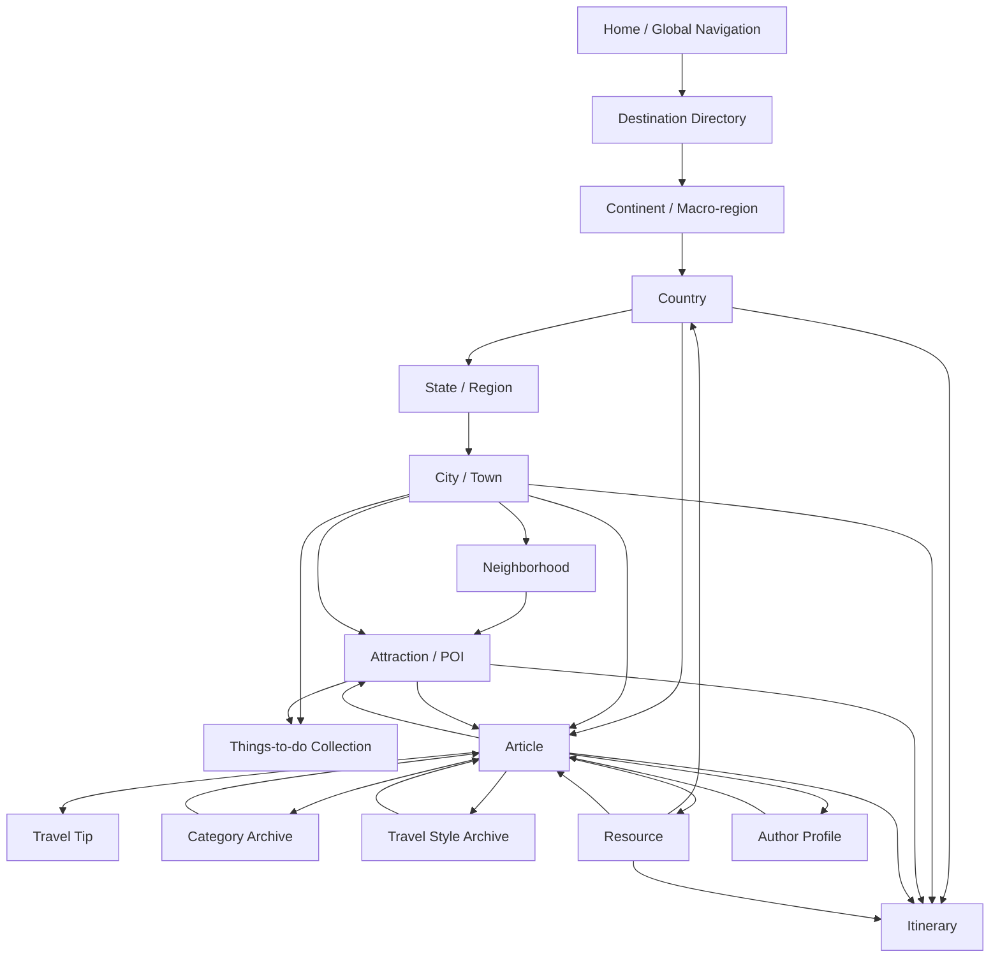
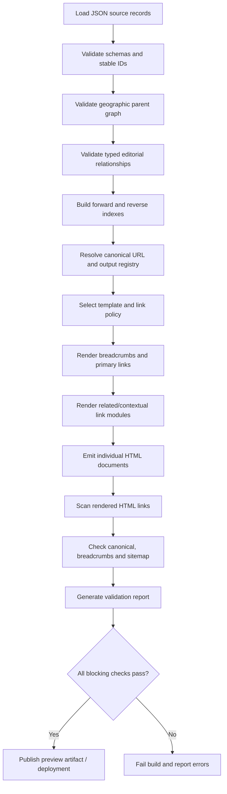

# Travel Guide — Internal Linking Architecture

- **Project:** Travel Guide
- **Phase:** 2.5 — Internal Linking Architecture
- **Document status:** Research and implementation specification
- **Research branch:** `research/travel-guide-blueprint`
- **Production branch:** `main` (not modified)
- **Prerequisites:** `COMPETITOR-ANALYSIS.md`, `SITEMAP.md`, `WEBSITE-ARCHITECTURE.md`, `DESTINATION-PAGE-HIERARCHY.md`, `ARTICLE-CONTENT-ARCHITECTURE.md`
- **Technical model:** Static JSON source → deterministic build-time indexes and validation → individual crawlable HTML documents
- **Runtime:** HTML5, CSS3 and Vanilla JavaScript enhancement only
- **Scope:** Site-wide link graph, relationship ownership, navigation and contextual links, breadcrumbs, recommendations, static generation, validation and scale

---

## 1. Purpose and governing decisions

This document defines how every public page discovers and links to other relevant pages. Internal linking is a controlled information-architecture system, not a collection of arbitrary links or a client-side routing mechanism.

### 1.1 Non-negotiable decisions

1. **The URL contract in `SITEMAP.md` is authoritative.** This document defines relationships and link generation; it does not create competing route families.
2. **The entity and parent-child contract in `DESTINATION-PAGE-HIERARCHY.md` remains authoritative.** Geographic hierarchy is separate from editorial association.
3. **Article, taxonomy, author and itinerary relationships follow `ARTICLE-CONTENT-ARCHITECTURE.md`.** Categories, tags, travel styles, audiences and themes are different dimensions.
4. **All relationship references use stable IDs**, never titles, display labels, filenames or array positions as identity.
5. **Every indexable URL resolves to its own physical HTML document** generated at build time. Internal links are ordinary HTML anchors with final canonical paths.
6. **The HTML delivered to a visitor already contains primary links, breadcrumbs and key recommendations.** JavaScript may enhance disclosure, filtering or interaction but must not be required to create essential links.
7. **Only published, approved, indexable and successfully generated records can be linked as public destinations.** Draft and preview-only content must not leak into production output.
8. **A link must have a reader purpose.** Link quantity is not a success metric; relevance, clarity, discoverability and integrity are.
9. **No automatic relationship is inferred from shared words alone.** A common country name or tag may support discovery, but does not prove that two pages are closely related.
10. **No SPA, backend, database or server-side runtime is introduced.** JSON data and indexes are processed at build time.

### 1.2 Two different graphs

Keep these systems separate:

- **Geographic graph:** strict, directed parent-child place relationships. A destination has at most one canonical geographic parent.
- **Editorial/content graph:** typed many-to-many associations among destinations, articles, itineraries, travel tips, resources, taxonomy pages, authors and other entities.

An article about a city is not a geographic child of that city. An itinerary that visits multiple countries is not a child of every country. These entities are connected by explicit editorial or route relationships.

### 1.3 Link semantics

A stored relationship does not automatically imply a visible reciprocal link. For every relationship type, the document specifies:
- **Source of truth:** the record/field that owns the relationship.
- **Direction:** the direction(s) in which a link may be rendered.
- **Placement:** the page module or context where the link belongs.
- **Eligibility:** publication, relevance and page-quality conditions.
- **Validation:** checks performed at build time.

The rendered graph is derived from source relationships and template policy. Do not maintain duplicated manually curated lists when the relationship can be derived safely.

---

## 2. Site-wide relationship model

### 2.1 Main entity families

| Family | Entity types | Typical URL family | Link responsibility |
|---|---|---|---|
| Geographic | Continent/macro-region, country, state/province/region, city/town, neighborhood, attraction/POI | `/destinations/...` | Parent, children, siblings, nearby places and place context |
| Destination discovery | Destination directory and things-to-do collections | `/destinations/`, `/things-to-do/...` | Group and curate geographic or activity discovery |
| Editorial | Articles and travel tips | `/articles/...`, `/travel-tips/...` | Connect guides to the places, routes and resources they actually discuss |
| Route planning | Itineraries and itinerary collections | `/itineraries/...` | Connect ordered stops, route context and planning articles |
| Taxonomy | Categories/subcategories and travel styles | `/travel/...`, `/travel-styles/...` | Discover published content in a meaningful classification |
| Reference | Resources | `/resources/...` | Provide useful planning tools and reference material |
| People | Authors | `/authors/...` | Attribute work and expose the contributor's published work |
| Site-level | Home, about, contact, legal and indexes | As specified in `SITEMAP.md` | Global orientation, trust and site navigation |

Tags, audience labels and editorial themes remain separate taxonomy dimensions. They do not acquire public archive links merely because an ID exists. Their URL/indexation policy remains the one established in Phase 2.4.

### 2.2 Relationship graph overview

The following diagram describes allowed conceptual paths. An arrow means a relationship can generate a link when its display policy and eligibility rules pass; it does not require an identical reciprocal link on the other page.



The destination-to-content and article-to-destination arrows represent editorial association. They do not change the geographic parent tree.

### 2.3 Link classes

| Link class | Meaning | Examples | Required behavior |
|---|---|---|---|
| Structural | Establishes site/place hierarchy | Home → destinations → country → city | Stable, predictable and crawlable |
| Parent/child | Expresses canonical geographic containment | Country → region; city → neighborhood | Derived from one parent ID |
| Contextual | Appears in useful editorial prose | City guide sentence → attraction page | Natural anchor text and direct relevance |
| Curated | Editor-selected recommendation | Related destination or popular guide | Explicit selection or approved scoring policy |
| Taxonomy | Classifies content | Category → article | Valid published member only |
| Attribution | Identifies authorship | Article → author profile | Must match visible byline |
| Utility/reference | Supports a planning task | Article → resource/checklist | Must serve the current task |
| In-page | Jumps to a section in the same HTML document | TOC → `#getting-around` | Unique stable fragment ID |

### 2.4 Link direction and ownership rule

- A canonical geographic parent owns its child collection by deriving records whose `parent_destination_id` equals that parent's ID.
- A destination owns explicit or validated references to relevant articles, itineraries and tips through destination relationship fields/indexes.
- An article owns its editorial associations, taxonomy IDs, author IDs and explicit related-article IDs.
- An itinerary owns its ordered stops and explicit related content.
- A category/style archive derives its eligible article list from taxonomy membership; it does not maintain a second copy of the article's classification.
- An author profile derives published authored work from `author_id` / credited contributor relationships; it must not be manually kept in sync with another article list.
- Resource relationships are explicit in the resource record or a typed relationship collection.
- Reverse lookup indexes are generated during the build. They are not a second source of truth.

---

## 3. Geographic linking architecture

### 3.1 Canonical geographic hierarchy

The canonical hierarchy follows Phase 2.3:

```text
Continent / Macro-region
└── Country
    └── State / Province / Region (optional)
        └── City / Town / Settlement
            └── Neighborhood / District (optional)
                └── Attraction / Point of Interest
```

Optional levels may be absent. A rural attraction may belong directly to a region or country when that is the correct canonical parent. Do not fabricate empty administrative pages to force a uniform tree.

### 3.2 Geographic relationship matrix

| From page | To page | Relationship source | Visible placement / rule |
|---|---|---|---|
| Continent | Country | Country `parent_destination_id` | Country directory/list grouped or paginated when needed |
| Country | Continent | Country's canonical parent ID | Breadcrumb and concise parent context |
| Country | State/region | Region `parent_destination_id` | Regions section only when meaningful |
| State/region | Country | Region's canonical parent ID | Breadcrumb and parent navigation |
| State/region | City | City `parent_destination_id` | Cities/settlements section |
| City | State/region or country | City parent and ancestor IDs | Breadcrumb and local context |
| City | Neighborhood | Neighborhood `parent_destination_id` | Neighborhoods section when content is useful |
| Neighborhood | City | Neighborhood's canonical parent ID | Breadcrumb and city context |
| Neighborhood | Attraction | Attraction `parent_destination_id` | Local attractions list where relevant |
| Attraction | Neighborhood/city/region/country | Attraction's canonical parent and ancestor IDs | Breadcrumb, location context and related places |
| Any destination | Sibling destinations | Same canonical parent, optionally curated | A limited nearby/related section; never substitute for parent-child links |

A page may display direct children and a small curated set of deeper descendant destinations. It must not dump every descendant from a large country onto the country page.

### 3.3 Parent-to-child rules

1. Derive children by querying the destination index for `parent_destination_id === current.destination_id`.
2. Filter to `status=published`, `indexable=true`, and existing generated canonical HTML.
3. Sort deterministically: editor-defined priority first where supplied, then a stable editorial/geographic order. Do not use random order.
4. For large collections, use crawlable pagination or a directory page. Do not place thousands of child anchors in one HTML block.
5. A child list can be grouped by destination type (regions, cities, neighborhoods, attractions) only where the current level and child data justify it.
6. The visible label is the entity's canonical display name. Add a qualifier such as region/country only when needed to disambiguate similar names.
7. Do not include thin, draft, withdrawn or noindex child records in a public index module. If the entity is useful but not independently indexable, link to an appropriate useful parent/collection page instead.

### 3.4 Child-to-parent rules

- Every destination page has a visible geographic breadcrumb chain generated from the canonical parent relationship.
- Add one concise contextual parent link where it helps users orient themselves; do not duplicate the same link in several nearby blocks.
- Attraction pages must provide a clear location path to their city and country (and intermediate region/neighborhood when those levels exist).
- A missing optional level is skipped. A false or placeholder parent is never inserted.
- Parent links are generated from resolved IDs and canonical URLs; no path is assembled by concatenating slugs.

### 3.5 Sibling and nearby destination rules

- Siblings share the same canonical parent. Siblinghood alone is not sufficient to label places "nearby".
- "Nearby" requires verified spatial/geographic data and a documented distance/area policy. If distance data is absent, label the module "More places in [parent]" or "Explore [region]" rather than "Nearby".
- "Related destinations" may be based on editor-curated IDs or valid shared context (same region, trip circuit, landscape/cultural focus) with explicit explanatory reason.
- Exclude the current page, its direct parent, duplicate canonical routes and already displayed links.
- Do not make a reciprocal relation mandatory: A may be relevant to B without B needing to recommend A.

### 3.6 Special case: direct attraction parent

An attraction can have a direct canonical parent of neighborhood, city, region or country according to the hierarchy document. Ancestor IDs may still identify its containing city and country. The attraction template should:
- use the actual parent chain in breadcrumbs;
- show a city link and country link when those IDs exist and are relevant;
- avoid inventing a neighborhood;
- avoid assigning multiple canonical parents to make the page appear in several hierarchies.

---

## 4. Destination-to-content linking

### 4.1 Destination → Articles

**Relationship source:** Article records own `destination_ids` (or the precisely typed destination relationship fields defined by the content schema). The build creates reverse indexes from destination ID to eligible article IDs.

Rules:
- A destination page lists only articles that materially help plan, understand or experience that destination.
- The primary destination relationship should be used for the strongest placement; secondary associations can appear in a lower-priority module.
- City articles may appear on the city page and a relevant country page through ancestor matching, but country pages should not repeat every city article without filtering.
- Country/region pages may show a curated selection spanning more than one city only when the article genuinely covers that broader geography.
- Attraction-specific articles belong on an attraction page when the article materially discusses that POI.
- Each item uses the canonical article URL, a unique title/excerpt and a useful image if supplied.
- Avoid duplicate cards in multiple modules on one page.

### 4.2 Destination → Itineraries

**Relationship source:** An itinerary record owns its destination associations and ordered stop IDs. Build reverse indexes for destination and stop lookups.

Rules:
- A destination page may display itineraries that start, end, pass through or substantially cover that destination.
- The itinerary must be published, indexable and have a valid route/stop model.
- A country page should distinguish country-spanning itineraries from city-specific day plans.
- A route that merely passes through a location should not outrank itineraries focused on it.
- If no itinerary is independently structured and useful, link to a relevant article instead of generating an empty itinerary module.

### 4.3 Destination → Travel Tips

- A travel tip is linked to a destination only when the guidance is destination-specific or materially affected by that location.
- General guidance (for example, choosing luggage) should not be copied to every destination page.
- Destination-specific visa, transport, safety, entry, season or local-etiquette advice must be reviewed for currency and source date before prominent display.
- A tip that has a standalone URL must use that canonical URL; do not create query-string copies for destination-specific variants.
- If the same tip applies to multiple destinations, reuse one canonical tip record and link it from relevant destinations.

### 4.4 Destination → Related destinations

Use one or more of:
- canonical parent/child proximity;
- verified geographic adjacency/distance;
- same explicitly defined trip circuit/region;
- editor-curated relationship with an explanatory reason;
- shared visitor planning context supported by records.

Do not treat a common tag, continent or broad country label as sufficient for a highly prominent recommendation. Use accurate labels such as "More in this country", "Explore nearby", or "Often combined with" according to evidence.

### 4.5 Attraction → City and Country

An attraction page must link to:
- its canonical parent breadcrumb;
- the containing city when `city_id` exists;
- the country when `country_id` exists;
- relevant neighborhood/region page when present and useful;
- optionally a related itinerary, things-to-do collection or article.

The city and country links should be visible without requiring JavaScript. They may appear in the location summary and breadcrumb, but should not be repeated in several recommendation cards.

### 4.6 Things-to-do collections

A things-to-do collection is an editorial/discovery entity, not a destination entity. It should link to:
- its primary destination;
- included attractions/activities that have canonical pages;
- relevant articles and itineraries when they add context;
- a broader destination page.

It must not become a second geographic parent for the POIs it lists. The collection's POI references do not change those POIs' `parent_destination_id`.

### 4.7 Example destination relationship mapping

Illustrative only; IDs and records must exist before use:

```json
{
  "destination_id": "city-kyoto-jp",
  "destination_type": "city",
  "parent_destination_id": "region-kyoto-jp",
  "country_id": "country-jp",
  "related_article_ids": ["article-kyoto-first-visit"],
  "related_itinerary_ids": ["itinerary-kyoto-3-days"],
  "related_tip_ids": ["tip-japan-local-transport"],
  "related_destination_ids": ["city-osaka-jp"],
  "things_to_do_collection_ids": ["things-kyoto-highlights"]
}
```

This is an illustrative projection of relationship fields, not a mandate to duplicate all relationships in the destination JSON. Prefer owning associations on the relevant content record and derive reverse relationships where possible.

---

## 5. Editorial linking architecture

### 5.1 Article → Related Articles

**Relationship source:** Article records own `related_article_ids` for editor-curated recommendations. Build indexes may also calculate candidate suggestions, but must never silently overwrite explicit editorial choices.

Rules:
- An article links to another article when it answers a connected next question, adds a different useful angle, supplies prerequisite context or provides a logical continuation.
- Exclude the current article, drafts, noindex records, duplicates, superseded pages and redirect-only URLs.
- Do not link to a near-duplicate article merely because it shares tags.
- Prefer the same primary subject or destination context only when the content genuinely matches.
- If the article is a comparison, link to the underlying destination/guide pages where useful and transparent.
- Related article links should have descriptive titles; avoid generic "click here".
- The relationship need not be reciprocal. If the second article does not benefit from recommending the first, do not force a reverse edge.

A relationship can carry metadata:

```json
{
  "target_article_id": "article-japan-rail-guide",
  "relationship_type": "next_step",
  "reason": "Explains the rail options needed to use the route in this guide",
  "priority": 1
}
```

If the article schema stores only string IDs, retain the IDs there and maintain richer relationship metadata in a separate typed relationship file only if implementation requires it. Do not alter the Phase 2.4 contract implicitly.

### 5.2 Article → Destinations

- Article owns destination associations.
- Link to the most relevant canonical destination page in the article body near the first meaningful mention where natural.
- An article may link to multiple destinations where its actual scope supports them.
- Do not add a large list of country/city links solely for SEO.
- The byline/article header and body remain editorial; destination links do not turn a destination into the article's breadcrumb parent.
- Link attraction mentions to POI pages only when those pages add practical detail beyond the sentence.

### 5.3 Article → Itineraries

- A route-focused article may link to its independently structured itinerary page.
- Itinerary detail pages can link back to an explanatory article, but only where that article adds context.
- An article and itinerary must have distinct purposes: article = editorial explanation/story; itinerary = ordered route/stop/day plan.
- If the page itself is the comprehensive canonical route plan, use the itinerary entity/template rather than duplicating an article detail page.
- Never create a loop of repeated "read the article / view itinerary" cards without distinct value.

### 5.4 Article → Travel Tips and Resources

- Link when it resolves a practical task that is relevant at that point in the article.
- A relevant checklist or resource may be linked in the body and once in a related-resource module; avoid duplicate placement unless the article is long and the two links serve clearly different moments.
- Commercial or affiliate resources must follow disclosure and editorial-integrity decisions in the earlier content architecture.
- External affiliate links are not internal links and must be tracked/validated under the external-link rules in Section 12.

### 5.5 Category → Articles

- Article's primary category is the authoritative classification.
- Category archive derives published, indexable articles whose `primary_category_id` matches it; secondary categories may be shown in a clearly subordinate section if useful.
- Do not store separate category-side lists that must be manually synchronized.
- Sort with explicit editorial priority or deterministic date order; do not call the newest list "popular" without analytics/evidence.
- Subcategory pages display their own eligible members and link to the parent category.
- Empty/thin category archive: do not publish it as an indexable page. Apply the Phase 2.4 archive/indexation policy.
- Pagination must use crawlable URLs where the sitemap and implementation support it.

### 5.6 Travel Style → Articles

- Travel style archive derives members through `travel_style_ids`.
- Travel styles are not categories: e.g. "solo travel" describes an approach/audience context, while "transport" is a topic.
- An article can belong to multiple styles only where its substance supports each.
- A travel-style page may include itinerary records as a distinct module when suitable, without pretending they are articles.
- Do not expose tag, audience or content-theme values as travel-style links.

### 5.7 Author → Published Articles

- Author profile derives articles from the canonical `author_id` / byline relationship.
- Show only public articles on which the person is genuinely credited.
- Contributor and reviewer relationships may be shown separately with explicit role labels; do not merge all contributors into "written by".
- A profile should not link to drafts, unpublished work or content that does not credit the person.
- An article links to the primary author profile near the byline; credited contributors/reviewers can link to their profiles when those profiles exist and the attribution is visible.
- Author profile's article list should be deterministic (for example, recent first with pinned featured work); no fabricated popularity ordering.
- If an author has no public articles, do not publish an empty indexable author archive.

### 5.8 Editorial link placement

| Page | Primary internal link placements |
|---|---|
| Article | Contextual body links, TOC anchors, destination context, itinerary/resources, related articles, author |
| Category | Parent category breadcrumb, relevant subcategories, eligible article cards |
| Travel style | Style breadcrumb, related styles if curated, articles and suitable itineraries |
| Author | Bio/context, authored articles, credited contributions with roles |
| Itinerary | Ordered stop links, destination overview, related article/tips/resources |
| Things-to-do | Primary destination, attraction cards, relevant itinerary and guides |

---

## 6. Resource linking architecture

### 6.1 Resource relationship model

Resources may include planning checklists, travel preparation references, packing lists, safety/planning explainers, route and transport references, downloadable static guides, or other useful reference pages defined by the sitemap.

A resource record should use typed references, for example:
- `destination_ids`
- `article_ids`
- `itinerary_ids`
- `category_ids`

These fields are illustrative until the definitive resource schema is created. The resource record is the source of truth for its associations; reverse indexes power links from other page families.

### 6.2 Resource → destinations

- Link a resource to destinations only when its instructions/facts are location-specific.
- A general packing checklist should not be linked from every city page as if it were city-specific.
- A visa/entry reference may associate with a country only when it has verified scope, source and last-reviewed metadata.
- A transport resource may relate to specific cities, regions or routes according to its actual coverage.

### 6.3 Resource → articles

- Articles link to resources when the reader needs a practical next step, template, checklist or deeper reference.
- A resource may list a small number of explanatory articles that help users apply it.
- Do not make the link reciprocal by default.
- Distinguish informational resource pages from partner offers. Affiliate disclosures apply where relevant.

### 6.4 Resource → itineraries

- A route-planning resource may link to itineraries that demonstrate how to use it.
- An itinerary may link to a packing, transport or planning resource when the resource supports the itinerary's actual requirements.
- Do not list all itineraries on a generic resource merely because both relate to travel.

### 6.5 Resource → categories

- Resource-to-category links are appropriate when the resource is part of a subject hub and the hub helps users discover related guidance.
- A category archive derives articles from their category membership, not from resources.
- Resource pages should not add category links solely to imitate a breadcrumb path. Breadcrumbs follow the resource's real navigation parent as defined in the sitemap.
- Categories may link to a small resource module when the resource is central to that topic.

### 6.6 Resource relationship example

```json
{
  "resource_id": "resource-international-trip-checklist",
  "destination_ids": [],
  "article_ids": ["article-plan-first-international-trip"],
  "itinerary_ids": [],
  "category_ids": ["category-travel-planning"]
}
```

An empty array means no explicit association, not "link to every page".

---

## 7. Breadcrumb architecture

### 7.1 General rules

1. Breadcrumbs represent the page's canonical information-architecture path, not every association connected to it.
2. The first item is the homepage, labelled consistently (for example, "Home").
3. All ancestors except the current page are clickable canonical links.
4. The current page is the final item, non-linked in the visible breadcrumb.
5. Breadcrumbs must match the page's canonical URL structure and visible navigation path.
6. Do not include optional geographic levels that do not exist.
7. Do not infer breadcrumb parents from `related_*_ids`, taxonomy tags or shared destinations.
8. Breadcrumb labels use the canonical display name for the linked page.
9. Keep the breadcrumb visible in server-generated HTML. JavaScript may enhance presentation but cannot be the only source.
10. JSON-LD `BreadcrumbList` must exactly mirror visible breadcrumb order, labels and URLs.
11. Do not render a self-link as the current crumb. Do not produce duplicate labels/URLs in a chain.
12. The breadcrumb must remain useful at mobile widths and have a semantic navigation label.

### 7.2 Breadcrumb specification by page family

| Page type | Breadcrumb order | Important exception |
|---|---|---|
| Homepage | Home | Usually no visible breadcrumb on homepage |
| Destination directory | Home → Destinations | Directory is the main geography index |
| Continent/macro-region | Home → Destinations → Continent | Use the directory page as parent |
| Country | Home → Destinations → Continent → Country | Skip continent only if the sitemap defines the country as direct directory child |
| Region/state | Home → Destinations → Continent → Country → Region | Use actual parent chain; skip missing levels |
| City/town | Home → Destinations → Continent → Country → Region (if exists) → City | A city may be directly under country |
| Neighborhood | Home → Destinations → … → City → Neighborhood | Use actual parent chain |
| Attraction/POI | Home → Destinations → … → Actual geographic ancestors → Attraction | Use parent hierarchy, not every ancestor ID blindly |
| Things-to-do collection | Home → Things to do → Country → City (or primary destination path) → Collection | Collection is editorial, not a geographic child |
| Article index | Home → Articles | No destination parent |
| Article detail | Home → Articles → Article title | Do not add its destination or category as parent by default |
| Category archive | Home → Travel → Category | Subcategory: Home → Travel → Parent category → Subcategory |
| Travel-style archive | Home → Travel Styles → Style | It is not a category |
| Itinerary index | Home → Itineraries |  |
| Itinerary collection | Home → Itineraries → Collection |  |
| Itinerary detail | Home → Itineraries → Itinerary title | Stops are not breadcrumbs |
| Travel tip detail | Home → Travel Tips → Tip title | A destination association does not replace this path |
| Resource index | Home → Resources |  |
| Resource detail | Home → Resources → Resource title | Use this path unless sitemap defines a true nested resource family |
| Author index | Home → Authors | Only if index page exists in sitemap |
| Author profile | Home → Authors → Author name | Do not include their latest article as a parent |
| About | Home → About |  |
| Contact | Home → Contact |  |
| Legal page | Home → Legal → Policy/Terms page | Match the legal index if present in sitemap |

**Canonical route note:** If `SITEMAP.md` represents a page family with a different exact route or omits a proposed directory parent, keep the breadcrumb link targets and labels consistent with the approved sitemap. Do not create a new route to satisfy a diagram.

### 7.3 Geographic breadcrumb generation algorithm

For a destination record:
1. Start with the current destination.
2. Follow `parent_destination_id` until the root destination or no parent.
3. Detect loops and missing IDs; either is a build failure.
4. Reverse the resolved parent sequence.
5. Prefix the canonical destinations directory link after Home.
6. Include each actual published/indexable ancestor with its canonical URL.
7. Append the current record as non-linked final crumb.
8. Verify the visible chain against `canonical_url` and destination type.

The continent can be included after Destinations when the continent record is the canonical parent. For direct roots or exceptional valid structures, use actual parents rather than hardcoding a fixed number of levels.

### 7.4 Article and content breadcrumb rules

Article breadcrumb remains Home → Articles → Article. Even if an article belongs to a category and discusses Japan, those associations are shown as taxonomy/destination links in dedicated modules or prose, not silently substituted into the breadcrumb.

A different visible editorial hierarchy is allowed only when:
- it is explicitly approved as the canonical navigation hierarchy;
- the same route is shown on the page consistently;
- the canonical URL policy remains coherent;
- structured data mirrors the exact visible breadcrumb.

Do not select a different primary category per page render based on the visitor's navigation path.

### 7.5 Breadcrumb JSON-LD specification

Use a `BreadcrumbList` with sequential `ListItem` positions beginning at 1. Every item except the current page has a canonical absolute URL. The current page may be represented as the terminal item with `item` omitted only when allowed by the chosen schema convention; implementation must validate against the supported schema form. Labels and item URLs must match the visible breadcrumb.

Illustrative JSON-LD shape:

```json
{
  "@context": "https://schema.org",
  "@type": "BreadcrumbList",
  "itemListElement": [
    {
      "@type": "ListItem",
      "position": 1,
      "name": "Home",
      "item": "https://example.com/"
    },
    {
      "@type": "ListItem",
      "position": 2,
      "name": "Articles",
      "item": "https://example.com/articles/"
    },
    {
      "@type": "ListItem",
      "position": 3,
      "name": "A Practical Guide to Kyoto",
      "item": "https://example.com/articles/practical-kyoto-guide/"
    }
  ]
}
```

`example.com` is a placeholder, not the production canonical host. The production host must be confirmed in implementation; do not emit this placeholder.

### 7.6 Breadcrumb accessibility

- Use `<nav aria-label="Breadcrumb">`.
- Use an ordered list for the sequence.
- Use anchors for ancestor pages.
- Mark current page with `aria-current="page"`.
- Decorative separators are hidden from assistive technology.
- Do not rely on color alone to indicate the current page.
- Keep focus order and labels clear.

---

## 8. Related content and recommendation system

### 8.1 Principles

Related-content modules are discovery aids, not automatic cross-link farms. Recommendations must:
- directly relate to current page intent;
- represent distinct content, not near-duplicates;
- be public, canonical, indexable and generated;
- avoid self-links and duplicate entries;
- explain their relationship through module labels or card context;
- use deterministic ordering;
- respect editorial exclusions and content freshness;
- provide a useful empty-state behavior (usually omit the module, not show filler).

### 8.2 Related destinations

Candidate sources, in preference order:
1. Explicit editor-curated `related_destination_ids` with a short reason.
2. Verified neighboring/nearby location data.
3. Same trip circuit or clearly defined region.
4. Same canonical parent when a "More in [parent]" module is appropriate.
5. Related destination associations from a genuinely shared itinerary or attraction group.

Do not infer proximity from shared country or broad taxonomy alone. Use separate labels for "Nearby", "More in this region" and "Often combined with". Limit the module to a small curated group (suggested default: 3–6). Do not show the same destinations already displayed in the page's main child list.

### 8.3 Related articles

Candidate ranking signals:
- explicit related article relationship;
- shared primary destination and actual subject;
- same primary category;
- one or more meaningful shared tags;
- same itinerary/topic when relevant;
- published state and indexability;
- content quality/review status and update validity.

Suggested candidate tiers (not a universal SEO formula):

| Tier | Candidate | Priority |
|---|---|---:|
| 1 | Explicit editor-curated relevant relation | Highest |
| 2 | Same primary destination + same/adjacent subject | High |
| 3 | Same primary category + clearly relevant destination/context | Medium |
| 4 | Shared meaningful tags/styles and verified topical overlap | Low |

A weighted score may rank candidates within a tier, but must not override hard exclusions. Shared destination alone is insufficient where the article subject is unrelated. A manual editor may suppress a candidate.

### 8.4 Popular guides

- "Popular" requires verified analytics, search/use data or a clearly described editorial selection method.
- Without analytics, use labels such as "Essential guides", "Editor's picks" or "Start here".
- Do not fabricate page views, clicks, ratings, booking counts or popularity order.
- Global popular-guide modules should be stable, curated and not overwhelm every page.
- On a destination page, popular means useful for the destination's reader task, not simply globally recent.

### 8.5 Nearby attractions

- Requires verified coordinates/geospatial distance or a maintained geographic-neighbor relation.
- Distance calculations must use a consistent documented method; straight-line distance is not travel time.
- Do not display travel times, walking distance or "nearby" labels unless supported by reliable routing/distance data.
- Exclude closed/retired/unpublished/unindexable POIs from public recommendations.
- Prioritize attractions in the same city/neighborhood and relevant to the page context.
- Suggested default is 3–8 cards depending on the page design; large directories should paginate or link to the city collection.

### 8.6 Related itineraries

Rank:
1. Itineraries whose primary destination exactly matches the current destination.
2. Itineraries that include the current destination as a meaningful stop.
3. Itineraries for the same trip circuit/region.
4. Explicit editorially associated routes.

A route that only mentions a location in passing must be excluded or ranked last. Do not infer itinerary relevance from a title keyword.

### 8.7 Contextual recommendations

Contextual links in prose should be the primary way to connect closely related concepts. Rules:
- Link the first or most useful occurrence of a phrase where a destination/article/resource page genuinely adds value.
- Use descriptive natural anchor text, not repeated exact-match keyword phrases.
- Do not link every repeated mention of the same entity.
- Avoid linking the current URL to itself.
- Avoid multiple adjacent anchors to the same destination.
- Do not add a link to a phrase when it interrupts meaning or creates a misleading promise.
- Link to authoritative external sources for factual claims where necessary; do not substitute an internal page for an independent source.
- Keep links keyboard-accessible and distinguishable from plain text.

### 8.8 Anti-repetition and deduplication rules

For each page's rendered recommendation set:
- Deduplicate by canonical URL, not by title.
- Exclude the current page and all redirects/aliases.
- Exclude duplicate entity IDs pointing to the same canonical URL.
- If the same target is relevant in two modules, retain the more contextually useful placement and suppress the weaker duplicate, unless a long page has a clearly separate later task.
- Do not repeat all hero cards in a lower "related" section.
- Do not repeat the same related article in both a featured module and the regular list.
- A target may appear once as a navigation/breadcrumb link and once in body context if those placements serve clearly different purposes; avoid repeated decorative cards.
- Set per-module caps and global per-page caps; tune after real content and user testing.
- No random recommendation order. Use stable sort and explicit manual priority.

### 8.9 Safe recommendation algorithm

```text
INPUT: current page, typed relationship indexes, published canonical page registry

1. Resolve explicit curated candidates.
2. Resolve valid contextual candidates from reverse/forward indexes.
3. Apply hard exclusions:
   - self, duplicate canonical, unpublished, noindex, missing output,
   - redirect-only, archived, superseded, editor-suppressed,
   - wrong relationship type, invalid or stale record.
4. Apply relevance constraints for the module label:
   - "nearby" requires geographic evidence,
   - "popular" requires evidence or must be relabelled,
   - "related" requires topical/editorial relevance.
5. Rank explicit editorial priority before deterministic derived signals.
6. Deduplicate by canonical URL.
7. Remove targets already shown in higher-priority modules on this page.
8. Enforce module and page caps.
9. Render only if enough meaningful candidates remain.
10. Log candidate reason and final chosen targets for review/debugging.
```

### 8.10 Recommendation reason metadata

Where practical, keep an internal reason code so a reviewer can understand why a link appeared:

| Reason code | Meaning |
|---|---|
| `editor_curated` | Explicit editor-selected link |
| `geographic_parent` | Canonical parent/child relation |
| `same_city` | Verified city relation |
| `verified_nearby` | Verified proximity relation |
| `same_itinerary` | Shared meaningful route |
| `same_primary_topic` | Relevant editorial subject |
| `next_step` | Useful continuation of reader task |
| `authored_by` | Genuine author attribution |
| `taxonomy_member` | Valid category/style membership |

These codes are build/debug metadata and do not need to appear in HTML.

---

## 9. Static JSON relationship and link-index architecture

### 9.1 Canonical record references

Records reference one another with IDs. Recommended link-relevant fields align with previous phases:

**Destination record**
- `destination_id`
- `destination_type`
- `parent_destination_id`
- ancestor IDs (`continent_id`, `country_id`, `region_id`, `city_id`, where applicable)
- `canonical_url`
- optional `related_destination_ids`

**Article record**
- `article_id`
- `destination_ids`
- `itinerary_ids`
- `attraction_ids`
- `related_article_ids`
- `primary_category_id`
- `category_ids`
- `tag_ids`
- `travel_style_ids`
- `audience_ids`
- `theme_ids`
- `author_id` and contributor/reviewer IDs
- `canonical_url`, `status`, `seo_metadata`

**Itinerary record**
- `itinerary_id`
- `destination_ids`
- ordered stops/days referencing destination/POI IDs
- `related_article_ids` and any approved resource/tip associations
- `canonical_url` and publication/indexability state

**Resource record**
- `resource_id`
- typed `destination_ids`, `article_ids`, `itinerary_ids`, and `category_ids` where relevant
- `canonical_url` and publication/indexability state

**Author record**
- `author_id`
- profile route/canonical URL
- role/profile publication state

Do not change field types already defined in Phase 2.3/2.4. If relationship metadata requires objects rather than IDs, introduce a versioned relationship contract in the relevant schema task rather than silently changing a prior document's contract.

### 9.2 Stable IDs vs URLs

- IDs are internal identity and remain stable when a title or slug changes.
- Canonical URLs are generated or validated from the approved route mapping and are the final link target.
- Slugs must not be used to resolve relationships.
- A relationship target ID must resolve to exactly one entity of the expected type.
- A canonical URL must resolve to exactly one eligible page record.
- URL aliases/old slugs belong in redirect data, not in relationship lists.
- Never store a full external URL in a field intended for an internal entity ID.

### 9.3 Build-time indexes

Build indexes once from loaded records; do not repeatedly scan every collection for every output page.

| Index | Key | Value |
|---|---|---|
| `destinationById` | `destination_id` | One destination record |
| `childrenByParentId` | `parent_destination_id` | Child destination IDs |
| `destinationsByAncestorId` | Ancestor destination ID | Relevant descendant IDs by type |
| `articlesByDestinationId` | Destination ID | Associated article IDs |
| `itinerariesByDestinationId` | Destination ID | Associated itinerary IDs |
| `tipsByDestinationId` | Destination ID | Associated tip IDs |
| `articlesByCategoryId` | Category ID | Published article IDs |
| `articlesByTravelStyleId` | Travel style ID | Published article IDs |
| `articlesByAuthorId` | Author ID | Credited published article IDs |
| `articlesByRelatedArticleId` | Article ID | Reverse related-article candidates (not forced links) |
| `resourcesByDestinationId` | Destination ID | Resource IDs |
| `resourcesByArticleId` | Article ID | Resource IDs |
| `resourcesByItineraryId` | Itinerary ID | Resource IDs |
| `entityByCanonicalUrl` | Normalized canonical URL | Entity ID and type |
| `pageByEntityId` | Entity ID | Output path, URL and publication state |
| `redirectByOldUrl` | Old path | Final destination path |

Additional indexes can be added when actual content volume/query patterns justify them. Do not precompute every possible pairwise relationship.

### 9.4 Reverse-index ownership

Reverse indexes are derived, disposable build artifacts. If a record changes:
- rebuild the affected index from canonical source records;
- do not edit reverse-index JSON manually;
- ensure deterministic ordering;
- reject duplicate IDs;
- write a version/manifest so stale generated indexes are not mixed with current source records.

### 9.5 Suggested relationship file layout

Consistent with the source tree in `WEBSITE-ARCHITECTURE.md`; exact directories should be finalized in implementation:

```text
src/
  data/
    destinations/
    articles/
    itineraries/
    travel-tips/
    resources/
    authors/
    taxonomy/
    relationships/          # only for relationships needing separate typed metadata
      curated-links.json
      destination-circuits.json
      suppressed-recommendations.json
  schemas/
  templates/
  scripts/
dist/
  ... one physical HTML file per public indexable URL ...
```

Do not create a duplicate relationship database. Use standalone relationship manifests only where the owning record cannot appropriately contain the relationship or where edge metadata (reason, priority, effective dates) is needed.

### 9.6 Example relationship manifest

```json
{
  "schema_version": 1,
  "relationships": [
    {
      "from": { "type": "article", "id": "article-kyoto-first-visit" },
      "to": { "type": "itinerary", "id": "itinerary-kyoto-3-days" },
      "type": "supports",
      "placement": "article_body",
      "reason_code": "next_step",
      "priority": 10,
      "status": "active"
    }
  ]
}
```

This is an optional typed edge format, not a required new content entity. Validate both endpoints, types, edge status and allowed relationship combinations.

---

## 10. Static link generation and HTML output

### 10.1 Build pipeline



### 10.2 Link resolution sequence

For every internal relationship:
1. Read target entity ID and expected type.
2. Resolve it in the correct `ById` map.
3. Check target publication/indexability state.
4. Resolve target canonical URL from the validated page registry.
5. Check that the final output HTML exists (or is scheduled in the same complete build).
6. Normalize/validate path and fragment.
7. Escape text and attribute values for HTML.
8. Render a normal `<a href="...">` anchor.
9. Record the source page, target page, relationship type and rendered placement in a build report.
10. Scan the final HTML again rather than trusting source metadata alone.

If an internal target is unresolved or not eligible, do not silently emit a broken link or replace it with an unverified URL. A required relationship failure blocks the build; an optional recommendation may be omitted only with a logged warning and explicit optionality.

### 10.3 Physical HTML requirement

Every indexable page outputs its own HTML document at the file path mapping established by `SITEMAP.md` and `WEBSITE-ARCHITECTURE.md`, generally:
- `/destinations/.../` → matching `index.html`
- `/articles/{slug}/` → `dist/articles/{slug}/index.html`
- `/itineraries/{slug}/` → `dist/itineraries/{slug}/index.html`
- `/travel/{category}/` → matching category archive HTML
- `/travel-styles/{style}/` → matching style archive HTML
- `/travel-tips/{slug}/` → matching tip HTML
- `/resources/{resource}/` → matching resource HTML
- `/authors/{author}/` → matching author HTML

The exact route-to-file mapping must be read from the approved sitemap/architecture and applied consistently. No client-side route resolver is permitted as the sole means of reaching these pages.

### 10.4 Anchor requirements

- Use absolute canonical URLs or root-relative canonical paths consistently; choose one project-wide policy during implementation.
- Root-relative links are safe only when the production site is deployed at the domain root (verify Cloudflare Pages configuration).
- Use trailing slash URL policy from `SITEMAP.md`.
- Internal links must not include tracking parameters.
- Do not link to branch-preview hosts from production HTML.
- Use fragments only when the target HTML contains the matching stable ID.
- A route change updates canonical mapping and redirect data; it does not require changing every relationship ID.
- Use descriptive anchor text and meaningful link context.
- Avoid empty anchors, nested interactive elements and JavaScript-only pseudo-links.

### 10.5 Native HTML examples

Breadcrumb:

```html
<nav aria-label="Breadcrumb">
  <ol class="breadcrumbs">
    <li><a href="/">Home</a></li>
    <li><a href="/destinations/">Destinations</a></li>
    <li><a href="/destinations/continents/asia/">Asia</a></li>
    <li><a href="/destinations/countries/japan/">Japan</a></li>
    <li aria-current="page">Kyoto</li>
  </ol>
</nav>
```

Contextual article link:

```html
<p>
  For local orientation, see the
  <a href="/destinations/countries/japan/cities/kyoto/">
    Kyoto city guide
  </a>
  before choosing your day trips.
</p>
```

Related article card:

```html
<article class="related-card">
  <a href="/articles/japan-rail-planning/">
    
    <h3>How to Plan Rail Travel in Japan</h3>
  </a>
  <p>Understand the route and ticket decisions before finalizing your itinerary.</p>
</article>
```

These snippets are structural examples only. Use real existing canonical routes and approved/licensed assets when implementing; the route/asset examples are not claims that these records already exist.

### 10.6 JavaScript boundaries

Vanilla JavaScript may:
- open/close a navigation drawer or disclosure module;
- enhance a large list with client-side filtering when the full crawlable page remains accessible;
- update visible state/ARIA attributes;
- load a non-critical search index on user interaction;
- provide an accessible "show more" interaction where the underlying links remain available in HTML or a crawlable paginated page.

It must not:
- create the only copy of core internal anchors from runtime API/network calls;
- replace normal `href` links with `onclick` navigation;
- hide essential geographic hierarchy or editorial links from the initial HTML;
- turn all pages into a single index.html SPA;
- make breadcrumb generation depend on browser storage or a user session.

### 10.7 Link and content output manifest

The build should emit a machine-readable report/manifest containing, at minimum:
- source entity ID/type/canonical URL;
- target entity ID/type/canonical URL;
- relationship type and reason code;
- page module/placement;
- whether the link was actually rendered;
- source record revision or build identifier;
- validation outcome.

This manifest assists audits and incremental rebuild planning; it is not a browser dependency.

---

## 11. Navigation, page-level links and pagination

### 11.1 Global navigation

Header/footer navigation remains the stable global navigation defined in `SITEMAP.md` and `WEBSITE-ARCHITECTURE.md`. It should expose main site sections, not every destination or every article.

- Use crawlable links for global section entry points.
- Use buttons for interactive menu controls, not fake links.
- Preserve keyboard, focus and ARIA behavior in desktop and mobile navigation.
- Keep header/footer links stable and avoid repeating a huge destination inventory sitewide.
- The footer may include selected major directories and legal/contact links, not thousands of destination anchors.

### 11.2 Destination navigation

Use local navigation only when the current destination has enough content to justify it:
- Overview
- Regions/cities/neighborhoods
- Attractions/things to do
- Articles and tips
- Itineraries
- Practical resources

Anchor links to page sections must point to unique stable IDs. Large collections should have dedicated directory pages or pagination.

### 11.3 Pagination

- Each paginated state must have a stable, crawlable URL if it is intended for discovery.
- Page 1 uses the preferred canonical for the collection; page 2+ use the implementation's approved canonical/indexation policy.
- Use normal previous/next/page-number anchors.
- Do not rely only on infinite scrolling or a JS "load more" button.
- Keep a sensible number of items per page based on content density/performance.
- Do not create indexable filter permutations for arbitrary category/tag/destination combinations.
- If a filtered state is only a UI convenience, it remains noindex and is not added to the XML sitemap.
- Pagination controls must not link to empty or out-of-range pages.

---

## 12. Link validation and quality gates

Validation runs against both source relationships and final generated HTML. Passing JSON schema validation alone is not enough.

### 12.1 Validation severity

| Severity | Meaning | Build behavior |
|---|---|---|
| **Error / blocker** | A required relationship, route or canonical contract is invalid | Fail build; block publishing |
| **Warning** | Optional link/recommendation is missing, weak or stale | Report; editor decision may be required |
| **Informational** | Non-blocking quality signal or improvement | Report for review |

### 12.2 Broken internal links

Check:
- every rendered local `href` resolves to a generated HTML document or valid asset/file;
- normalized route maps to exactly one canonical page;
- target page is published and eligible for linking;
- fragment target exists in destination HTML;
- internal links do not point to redirects when direct final URL is available;
- no link points to a preview host or a different production hostname;
- links are not malformed or double-encoded;
- no self-links exist in body/recommendation modules (current breadcrumb label is not an anchor).

Required internal link failure is a blocker. Missing optional recommendation can be a warning only when the module policy explicitly permits omission.

### 12.3 Broken external links

External-link checking must be cautious:
- Extract unique external HTTP(S) URLs from rendered pages and manifests.
- Ignore mailto/tel and known non-HTTP schemes in the HTTP checker.
- Avoid sending private, draft or preview content.
- Use rate limits, timeouts and a documented user agent.
- Handle 3xx redirects, 403/429 anti-bot responses and transient 5xx separately.
- A 403/429 is not automatically proof that a link is broken; retry under controlled policy or mark "unable to verify".
- Flag confirmed 4xx/410, DNS/TLS failures and dead domains for review.
- Do not follow unsafe schemes or arbitrary redirect targets.
- Respect robots policies and website terms; do not crawl aggressively.
- Recheck high-value volatile links more frequently and low-risk references less often.
- External-link failure is generally a warning/editorial review, not an automatic whole-site build blocker, unless the link is legally, safety or transaction critical.

Store `last_checked_at`, status, final URL (if redirected), and check outcome in a QA report, not as user-facing claims.

### 12.4 Orphan pages

A page is an orphan when it has no meaningful incoming internal path from the eligible public site graph.

Check:
- all sitemap URLs have at least one incoming internal link from a crawlable page (except intentionally isolated/utility cases with documented exceptions);
- pages are reachable from a relevant directory, parent, taxonomy, author or editorial path;
- a page has a path from Home through navigation/directory links;
- pagination does not strand later pages;
- new published content is connected on publish.

Differentiate:
- **Hard orphan:** no incoming internal links.
- **Soft orphan:** only a link from an irrelevant/low-value or noindex page.
- **Deep page:** reachable but beyond the project's agreed crawl-depth target.
- **Exception:** a utility, legal, campaign or transactional page intentionally not included in normal discovery, documented in an allowlist and handled by sitemap/indexation policy.

Orphan detection uses a crawl from known entry URLs and reverse-link index analysis. A record relationship alone does not prove that a visible HTML link exists.

### 12.5 Duplicate links

Check:
- repeated same-target anchors within a module;
- repeated card targets across modules on one page;
- duplicate canonical URLs from different records;
- duplicate link entries caused by both explicit and derived relations;
- redundant links with identical anchor and destination in adjacent content;
- repeated links created by desktop/mobile duplicate navigation markup where both are exposed simultaneously.

Some repeated links may be legitimate (breadcrumb and contextual body link); report placement context and use policy rather than blanket failure.

### 12.6 Invalid URLs

Normalize and validate:
- leading/trailing slash and trailing-slash convention;
- valid URL encoding;
- no spaces or malformed percent escapes;
- no accidental double slash (except protocol separator);
- no query tracking in internal canonical links;
- canonical host and HTTPS policy;
- no localhost, preview or development host in production output;
- no unknown route prefix;
- no path traversal or encoded traversal;
- no invalid fragment;
- no duplicate normalized route;
- internal links remain within approved site origin after normalization.

Invalid internal URLs are blockers.

### 12.7 Missing canonical URLs

Every public indexable HTML page must have exactly one valid absolute canonical URL. Validate:
- canonical exists and matches the page registry;
- it uses the selected HTTPS production hostname;
- it is self-referencing for the preferred canonical route;
- it contains no tracking parameters or preview host;
- no two distinct indexable entities claim the same canonical;
- redirect aliases do not appear as canonical pages.

The production hostname must be verified during implementation before final output generation.

### 12.8 Missing/invalid breadcrumbs

For every page type covered by Section 7:
- breadcrumb nav exists in rendered HTML;
- first item is Home where applicable;
- parent sequence is resolvable;
- final crumb equals current visible page;
- no self-linked final item;
- labels and URLs are unique within the chain;
- JSON-LD breadcrumb mirrors visible order;
- all parents use canonical URLs;
- article breadcrumbs are not accidentally geographic;
- taxonomy and author paths follow their own family rules.

If the homepage intentionally omits visible breadcrumbs, this is an explicit template exception.

### 12.9 Redirect chains and loops

- Every historical slug/alias maps directly to the final canonical URL.
- Detect cycles and self-redirects.
- Resolve redirects during the build and report the full chain.
- Rewrite internal links to the final route rather than relying on redirects.
- Avoid A → B → C chains; old paths should redirect directly to C.
- Do not redirect unrelated retired content to the homepage.
- For deleted content, select an appropriate not-found/gone or relevant replacement policy; do not create misleading redirects.
- Redirect mechanism must be compatible with the chosen Cloudflare Pages deployment configuration and verified at implementation.

### 12.10 Incorrect parent-child relationships

Validate:
- every non-root destination has at most one `parent_destination_id`;
- referenced parent exists and is an allowed geographic type;
- child type is valid under parent type policy;
- no cycles;
- ancestor IDs match the resolved parent chain;
- a child slug is unique within its route scope;
- no unrelated non-geographic entity is assigned as a parent;
- attraction's parent may be a neighborhood, city, region or country per the approved hierarchy;
- optional missing levels are skipped rather than fabricated;
- children are derived from parent IDs, not maintained as divergent duplicated lists.

A parent-child inconsistency is a blocker because it can corrupt breadcrumbs, directories and page URLs.

### 12.11 Additional quality checks

- broken external target or volatile link stale date;
- noindex/draft target leaked through a relationship;
- sitemap page absent from output or output missing from sitemap;
- duplicate titles/near-duplicate content flagged for editorial review;
- invalid taxonomy ID or mismatched entity type;
- page not linked from any relevant collection;
- excessive link density or oversized child list;
- misleading "nearby", "popular", "best" or "most booked" labels without supporting data;
- inaccessible link text or non-keyboard-operable controls;
- page with no meaningful outbound internal path to the wider site.

---

## 13. Sitemap and index consistency

### 13.1 Three inventories must agree

1. **Source registry:** every eligible published/indexable entity and its canonical URL.
2. **Generated HTML registry:** every physical HTML document actually emitted.
3. **XML sitemap registry:** every URL submitted for search engine discovery.

For each eligible indexable record, one canonical route should map to one generated document and one sitemap URL. Redirect-only aliases, noindex pages, drafts and preview URLs are excluded.

### 13.2 Required set comparisons

Let:
- `P` = canonical URLs of eligible published/indexable source records;
- `H` = canonical URLs represented by generated HTML output;
- `S` = canonical URLs in the XML sitemap.

Required:
- `P = H` for the set of pages expected to be generated;
- `H = S` for the set of indexable pages submitted to the sitemap;
- `S` contains no redirect, noindex, draft or duplicate URL.

Exceptions must be documented (for example, a page intentionally generated but noindex). Keep separate explicit sets for indexable and non-indexable output so the comparison remains auditable.

### 13.3 Internal-link graph vs sitemap

- Sitemap presence does not satisfy internal-link discoverability.
- Every ordinary content page should have an incoming path from a relevant indexable page.
- Directory pagination and content hubs must expose deeper pages.
- Sitemap entries must resolve directly to final canonical HTML, not a redirect.
- The source relationship graph should not generate links to URLs omitted from the public page registry.

### 13.4 Large sitemap files

Follow the XML sitemap limits and index strategy adopted in `WEBSITE-ARCHITECTURE.md`. At scale, split files by content family or stable partitions and use a sitemap index. The source of truth remains one generated canonical URL registry; do not manually maintain separate page lists for each sitemap.

---

## 14. Scalability for thousands of static HTML pages

### 14.1 Complexity strategy

Do not re-scan every article, destination and itinerary for every page. Load data once, validate once, construct indexes once, and render each page using targeted lookups.

Preferred approximate work:
- source loading: O(N);
- ID/type uniqueness checks: O(N);
- building forward/reverse indexes: O(N + E), where E is the number of explicit relationship edges;
- parent/ancestor graph validation: O(N) with visited-state tracking;
- per-page link assembly: proportional to that page's bounded relationship candidates;
- final output link scan: O(total rendered anchors).

Avoid all-pairs comparison (O(N²)) for related content. Candidate matching should use inverted indexes and bounded top-K candidates, then editorial review for ambiguous matches.

### 14.2 Deterministic indexes and sorted output

- Use stable sort keys: editor priority, relevance tier, publication date or canonical ID.
- Normalize IDs and URLs once.
- Deduplicate at index-build time and again at final render boundary.
- Keep index data compact; do not embed every page's entire content body in every page.
- Generate reverse indexes as build artifacts and discard/rebuild them rather than editing them by hand.
- Shard or partition data only when measured build/memory/search performance warrants it.
- Avoid a giant browser-side link graph download.

### 14.3 Incremental rebuild dependencies

When a record changes:
- destination parent change → rebuild that destination, ancestor/descendant navigation affected, breadcrumb paths, destination directories and dependent indexes;
- article destination association change → rebuild article and relevant destination pages;
- article category/style/author change → rebuild article, old/new archives and old/new author pages;
- itinerary stop change → rebuild itinerary and affected destination/attraction pages;
- resource association change → rebuild resource and affected destinations/articles/itineraries/categories;
- canonical/slug change → rebuild target, update redirect registry, relevant linking pages and sitemap;
- template/link-policy change → rebuild all affected page families.

An initial full deterministic build is preferred. Incremental invalidation must be proven against a full build before relying on it.

### 14.4 Avoid oversized pages

- Do not include all children or all related items on a parent with thousands of descendants.
- Use curated top items, paginated directories and dedicated collection pages.
- Keep the link graph rich through sensible paths, not huge HTML lists.
- Avoid loading every JSON data file in every browser session.
- Use a static search index only for search; actual content pages remain direct HTML.
- Monitor output size, build duration, link count, memory and crawl depth.

### 14.5 Crawl depth policy

Recommended design target, not a guaranteed search-engine ranking rule:
- homepage → primary directory/hub: 1 click;
- directory/hub → continent/country/category/style/index: 1–2 clicks;
- parent destination → child destination: usually 1 click;
- destination/article/itinerary pages → closely relevant supporting pages: usually 1 click;
- deep POIs and long archives remain reachable through paginated/categorized hubs.

A useful page should not require navigating through unrelated pages to be discovered. Report pages that exceed the target depth and improve hub/parent links rather than generating sitewide links everywhere.

---

## 15. Automated link-checking workflow

### 15.1 Pull-request / branch validation

For every content or template change on a working branch:

1. Parse all source JSON and validate schemas.
2. Validate unique IDs, types, slugs and canonical URL ownership.
3. Validate geographic parent relationships and ancestor chains.
4. Validate all typed editorial references and relationship permissions.
5. Build forward/reverse indexes.
6. Resolve canonical URLs and output paths.
7. Render affected static HTML (or full output for the initial implementation).
8. Extract every `href`, `src`, canonical and fragment from generated output.
9. Validate internal documents, fragments, assets and allowed origin.
10. Validate breadcrumbs against source graph and visible HTML.
11. Validate redirect map for duplicate targets, cycles and chains.
12. Compare expected indexable registry, HTML output and XML sitemap.
13. Crawl from homepage and major hubs; detect orphan, soft-orphan and deep pages.
14. Run curated recommendation deduplication/relevance checks.
15. Run rate-limited external link check where configured; report unverifiable responses separately.
16. Produce a machine-readable JSON report plus concise human-readable summary.
17. Fail the check on blocking errors; warnings require disposition before release where specified by editorial policy.
18. Inspect generated preview and accessibility/keyboard behavior before approval.

### 15.2 Validation report fields

Suggested report:

```json
{
  "build_id": "commit-sha-or-build-id",
  "branch": "research-or-content-branch",
  "summary": {
    "source_records": 0,
    "generated_html_pages": 0,
    "indexable_pages": 0,
    "internal_links_checked": 0,
    "external_links_checked": 0,
    "broken_internal_links": 0,
    "broken_external_links": 0,
    "orphans": 0,
    "duplicate_links": 0,
    "missing_canonicals": 0,
    "missing_breadcrumbs": 0,
    "redirect_chains": 0,
    "relationship_errors": 0
  },
  "issues": [
    {
      "severity": "error",
      "code": "BROKEN_INTERNAL_LINK",
      "source_url": "/articles/example/",
      "target_url": "/destinations/example/",
      "relationship_type": "destination_context",
      "message": "Target route is not present in generated page registry"
    }
  ]
}
```

Counts are zero placeholders, not measured project results. Build ID should be the commit SHA or an immutable build identifier.

### 15.3 Release gates

| Check | Severity |
|---|---|
| Invalid required IDs/types or geographic parent cycle | Blocker |
| Broken internal link or missing fragment | Blocker |
| Missing/duplicate canonical URL for indexable page | Blocker |
| Missing breadcrumb on required page type | Blocker |
| Sitemap/output registry mismatch | Blocker |
| Draft/noindex content linked publicly | Blocker |
| Redirect loop or chain | Blocker |
| Missing incoming link for a normal content page | Blocker or explicitly reviewed exception |
| Broken external link (non-critical) | Warning |
| External link cannot be verified due to 403/429/transient issue | Informational / recheck |
| Weak or repetitive related recommendation | Warning |
| High crawl depth | Warning |
| Link-density concern | Warning |
| Near-duplicate editorial content | Editorial review warning |

### 15.4 Scheduled maintenance

The project may run a periodic external-link audit and revalidate volatile travel references on a cadence appropriate to risk. This is an implementation/operations choice; this document does not create a scheduled job. Internal link graph validation should run on every relevant build because source changes can introduce broken references immediately.

---

## 16. Accessibility, UX and performance requirements

- Use semantic anchors with real `href` targets.
- Keep link labels descriptive out of context.
- Do not use "click here" as the only link text.
- Preserve visible focus states and keyboard access.
- Avoid making an entire card and nested title separate duplicate anchors; choose a clear clickable structure.
- Use headings and list semantics for link groups.
- Give navigation landmarks distinct accessible labels where there are multiple nav regions.
- Ensure breadcrumbs work in reading order and announce current page.
- Use a text link alongside icon-only controls or provide an accessible name.
- Do not rely solely on hover to expose nested links.
- Keep recommendation modules bounded so HTML remains manageable.
- Link blocks should not shift layout excessively when images load; use image dimensions as required by the media architecture.
- Avoid downloading a full site-wide relationship index in the browser.
- Prefer static HTML anchors so navigation works without JavaScript and remains robust for crawlers and assistive technologies.
- Test real keyboard, mobile and screen-reader behavior before claiming accessibility conformance.

---

## 17. Implementation boundaries and unresolved choices

| Topic | Architecture decision | Implementation still required |
|---|---|---|
| Relationship ownership | One source record owns each relationship type; reverse indexes derived | Confirm exact JSON schema paths and migrate source data |
| Geographic graph | Single canonical parent; optional levels skipped | Implement graph validator |
| Editorial graph | Typed many-to-many IDs, not geographic parentage | Define relationship type registry |
| Related content | Explicit first; relevance-ranked derived candidates second | Tune caps and scoring using real content |
| Breadcrumbs | Page-family-specific canonical path | Implement template resolver and JSON-LD output |
| URL normalization | Sitemap trailing-slash and canonical policy | Verify final Cloudflare Pages hostname/base path |
| Link generation | Build-time normal anchors in individual HTML files | Implement generator and render helpers |
| Orphan detection | Crawl graph plus incoming-link analysis | Implement crawler/report and exception registry |
| External links | Rate-limited checks with unverifiable state | Choose check cadence/tool and safe request policy |
| Redirects | Direct old-route → final-route mapping | Verify Cloudflare Pages redirect configuration |
| Pagination | Stable crawlable pages; arbitrary filters noindex | Define page size and canonical policy per collection |
| Incremental builds | Dependency graph with full-build correctness | Implement and compare to full build |

No HTML, CSS, JavaScript, JSON content records, schema files, generator, automated workflow or Cloudflare settings have been implemented by this research document.

---

## 18. Phase 2.5 acceptance checklist

- [x] Geographic relationship graph and continent/country/region/city/neighborhood/attraction rules defined.
- [x] Parent-child and reverse-child derivation rules defined.
- [x] Optional geographic levels and direct attraction parents handled.
- [x] Destination → articles relationships defined.
- [x] Destination → itineraries relationships defined.
- [x] Destination → travel tips relationships defined.
- [x] Related destinations and attraction → city/country links defined.
- [x] Editorial article/itinerary/destination/category/style/author relationships defined.
- [x] Resource relationships to destinations, articles, itineraries and categories defined.
- [x] Breadcrumb rules specified for geography, articles, categories, itineraries, tips, resources, authors and site pages.
- [x] Breadcrumb HTML, accessibility and JSON-LD consistency specified.
- [x] Related destinations, articles, popular guides, nearby attractions, itineraries and contextual recommendations governed.
- [x] Repetition, duplicate recommendation and relevance controls defined.
- [x] Static JSON ID resolution, forward/reverse indexes and generated link manifest defined.
- [x] Build-time link generation and physical HTML output requirements specified.
- [x] Vanilla JavaScript boundaries specified; no SPA routing introduced.
- [x] Broken internal/external links, orphans, duplicates, invalid URLs and fragments checks defined.
- [x] Canonical, breadcrumb, redirect chain and geographic relationship validation defined.
- [x] Sitemap/source/output consistency and crawl depth strategy defined.
- [x] Scalable index and O(N + E) build strategy specified for thousands of pages.
- [x] Automated branch validation, reporting and release gates defined.
- [x] Production code, main-branch changes and merge are excluded.

**Phase 2.5 status:** Internal Linking Architecture specification prepared. This document is a research/architecture deliverable only; it does not implement production pages, content data, JavaScript, build scripts or CI workflows.

**Next task:** Phase 2.6 — Final Architecture Documentation. Consolidate and cross-check the approved architecture decisions from Phases 2.1–2.5, identify any conflicts or unresolved implementation decisions, and prepare the final coherent architecture handoff without beginning production implementation.
